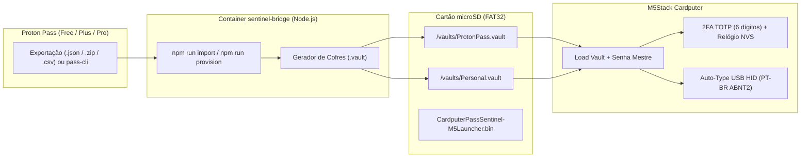

# 🛡️ Cardputer Pass Sentinel — Proton Pass `.vault` Manager & 2FA USB HID

[](LICENSE)
[-blue.svg)](https://docs.m5stack.com/en/core/Cardputer)
[](https://github.com/geo-tp/Password-Manager)
[](./bridge)

O **Cardputer Pass Sentinel** é um gerenciador de senhas físico e autenticador **2FA (TOTP)** para o **M5Stack Cardputer (ESP32-S3)**, combinando a interface fluida e o formato de arquivos `.vault` no cartão microSD do [`geo-tp/Password-Manager`](https://github.com/geo-tp/Password-Manager) com a importação completa das suas credenciais e segredos 2FA do **Proton Pass** (incluindo contas **Free**, **Plus** e **Professional**).

---

## ✨ Funcionalidades Principais

- **Arquitetura e UX `geo-tp/Password-Manager` Aprimorada:**
  - Navegação em carrossel horizontal (`Load Vault`, `Create Vault`, `Date & Time`, `Settings`) com ícones vetoriais e abertura instantânea de cofres grandes (parsing JSON *zero-copy* em RAM).
  - **Organização automática em listas de até 100 senhas + 2FA separado:** Gera `01_2FA.vault`, `02_Detran.vault`, `03_Personal_1-L.vault`, `04_Personal_L-Y.vault` e o cofre unificado `ProtonPass.vault` (que possui menu interno de grupos `* 2FA`, `Detran`, `Personal 1-L`, `Personal L-Y`).
  - **Desbloqueio único na sessão:** Digite a senha mestre (`9868`) apenas no primeiro cofre aberto; ao trocar de cofre na mesma sessão, o Cardputer reutiliza a senha da sessão automaticamente.
  - Criação, edição e exclusão de entradas (`Add Entry`, `Delete Entry`) diretamente no Cardputer.
- **Autenticador 2FA (TOTP RFC 6238) Dinâmico em Tempo Real + Sincronização de Relógio Wi-Fi NTP / Setas:**
  - Calcula e **atualiza dinamicamente a cada 1 segundo** os códigos **2FA de 6 dígitos** (`123 456 (28s)`) tanto na lista de campos da credencial quanto na tela dedicada do `2FA`.
  - **Configuração perfeita de Data e Hora (`Date & Time`):**
    1. **`Sync Wi-Fi (NTP)`**: Escaneia as redes Wi-Fi 2.4 GHz ao redor, permite selecionar o SSID na tela, sincroniza a hora exata ao segundo via NTP (`a.st1.ntp.br` / `pool.ntp.org`, fuso `BRT` UTC-3) e desliga o Wi-Fi imediatamente.
    2. **`Manual Clock (Arrows)`**: Relógio visual interativo controlado pelas setas `,` `/` (escolhe Dia, Mês, Ano, Hora, Minuto ou Segundo) e `;` `.` (`+1` / `-1`), permitindo cravar o segundo `:00` com `Enter`.
- **Teclado USB HID Nativo com Layout `Portuguese (BR)` ABNT2 + Atalhos Diretos (`U`, `P`, `T`, `N`):**
  - **Envio imediato por tecla de atalho:** Na tela da credencial, basta pressionar **`U`** (User), **`P`** (Pass), **`T`** (2FA de 6 dígitos) ou **`N`** (Note) para que o Cardputer digite o valor **diretamente via USB** e permaneça na mesma tela (permitindo enviar `U` → `P` → `T` em sequência!).
  - **Detecção automática de conexão USB (`tud_ready`):** Se o cabo USB **não** estiver conectado a um computador (ou se você selecionar a linha com as setas e pressionar **`Enter / OK`**), o Cardputer abre normalmente a tela de detalhes do campo (`View`, `Edit`, `Update`).
  - Respeita acentos e caracteres especiais do teclado brasileiro **ABNT2** (além de `US`, `UK`, `FR`, `DE`, `ES`, `IT`, `PT`, `SE`, `DA`, `HU`).
- **Compatível com Contas Proton Pass Free, Plus e Pro:**
  - Importa diretamente exportações do Proton Pass (`.zip`, `.json`, `.csv` ou `.pgp`) e gera automaticamente todos os arquivos `.vault` cifrados (`PBKDF2-HMAC-SHA256` 10.000 iterações + `AES-128-ECB PKCS#7` + `SHA-256 Checksum`).

---

## 🏛️ Fluxo de Funcionamento



---

## 🚀 Como Usar (Passo a Passo Rápido)

### 1. Importar suas senhas do Proton Pass e gerar os arquivos `.vault`

Coloque o arquivo exportado do Proton Pass (`data.json` ou `.zip`) na pasta `./provision-out/` e execute:

```bash
# Importa as credenciais + 2FA e já gera os arquivos .vault em ./provision-out/vaults/
docker exec -it sentinel-bridge npm run import
```

> Por padrão, os arquivos `.vault` são gerados com a senha mestre configurada em `CARDPUTER_MASTER_PASSWORD` (padrão `9868`), ou você pode escolher outra executando `docker exec -it sentinel-bridge npm run provision`.

### 2. Copiar para o Cartão microSD

Copie para o seu cartão microSD (FAT32):
1. **Firmware para M5Launcher:** [`releases/CardputerPassSentinel-M5Launcher.bin`](./releases/CardputerPassSentinel-M5Launcher.bin) *(ou [`releases/CardputerPassSentinel-Merged-0x0.bin`](./releases/CardputerPassSentinel-Merged-0x0.bin) para gravação via M5Burner/esptool)*.
2. **Cofres `.vault`:** Copie a pasta `./provision-out/vaults/` (contendo `ProtonPass.vault`, `Personal.vault`, etc.) para o cartão microSD.

### 3. Abrir o Cofre e Usar o 2FA no Cardputer

1. Ligue o Cardputer, selecione **Load Vault**, escolha o arquivo `.vault` no cartão SD e digite a sua **Senha Mestre**.
2. Para usar códigos **2FA (TOTP)**:
   - Vá em **Date & Time** no menu principal (ou pressione **`T`** na tela de visualização do campo `2FA`) e digite os **4 dígitos da hora atual** (`HHMM`, ex: `1545`) ou `DD/MM/YYYY HH:MM`.
   - Dentro de qualquer credencial, pressione **`U`** (User), **`P`** (Pass), **`T`** (2FA) ou **`N`** (Note) e escolha **Keyboard** para enviar via USB HID ou **View** para ver na tela!

---

## 📂 Documentação Adicional

- [`docs/HARDWARE_SETUP.md`](./docs/HARDWARE_SETUP.md) — Guia detalhado de uso no M5Stack Cardputer, atalhos de teclado, ajuste de relógio 2FA e Docker.
- [`docs/PROTOCOL_SPEC.md`](./docs/PROTOCOL_SPEC.md) — Especificação técnica do formato binário `.vault` (`PBKDF2-HMAC-SHA256` + `AES-128-ECB` + `SHA-256 Checksum`) e `CPVAULT v1`.
- [`docs/SECURITY_MODEL.md`](./docs/SECURITY_MODEL.md) — Modelo de segurança, criptografia em repouso e proteção contra keyloggers via USB HID.
