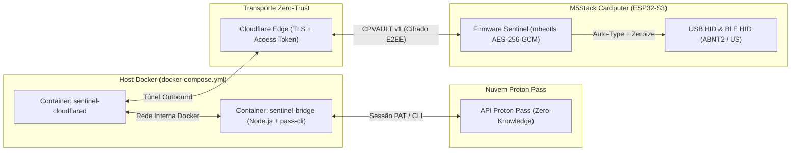

# 🛡️ Cardputer Pass Sentinel — Proton Pass Hardware Vault & HID Injector

[](LICENSE)
[-blue.svg)](https://docs.m5stack.com/en/core/Cardputer)
[](./bridge)

O **Cardputer Pass Sentinel** é um ecossistema *open-source* de custódia física e injeção de credenciais (*Hardware Password Manager & Auto-Type Authenticator*) para o **M5Stack Cardputer (ESP32-S3FN8)** com sincronização bidirecional ao **Proton Pass**.

---

## ✨ Destaques da Arquitetura

- **Projetado para 512 KB de SRAM (Sem PSRAM):** Formato binário indexado customizado (**`CPVAULT v1`**) que mantém apenas um índice compacto em memória volátil (~60 bytes/item) e **decifra cada senha ou segredo TOTP sob demanda direto da Flash (`LittleFS`)**, limpando a RAM (`mbedtls_platform_zeroize`) imediatamente após o uso.
- **Zero-Trust End-to-End Encrypted (E2EE) sobre Cloudflare Tunnel:** Ideal para redes domésticas atrás de CGNAT ou bloqueadas pela operadora. O container `sentinel-cloudflared` expõe o serviço sem abrir portas no roteador, enquanto todo o payload trafega cifrado em **AES-256-GCM** com autenticação **HMAC-SHA256 anti-replay** — a Cloudflare jamais tem acesso às suas credenciais em texto limpo.
- **Envelope Encryption (`KEK` + `DEK`) & Auto-Wipe:** A chave do cofre (`DEK`) nunca é gravada em texto limpo na Flash; ela é embrulhada por uma `KEK` derivada da sua Senha Mestra/PIN local via `PBKDF2-HMAC-SHA256` ($100.000$ iterações) acelerado por silício no ESP32-S3, com *Auto-Wipe* após 10 tentativas inválidas.
- **Injeção Dupla (`USB HID` + `BLE HID`) com Layout `PT-BR ABNT2` e `US ANSI`:** Funciona como teclado físico USB-C em qualquer PC/Mac/Linux/BIOS (imune a keyloggers de software e captura de clipboard) ou via Bluetooth Low Energy no telemóvel, traduzindo acentos e símbolos complexos (`@`, `"`, `'`, `\`, `|`, `?`, `/`) para o layout correto.
- **Autenticador 2FA TOTP Integrado (RFC 6238):** Calcula códigos de 6 dígitos localmente via `HMAC-SHA1` com barra regressiva de 30 segundos sincronizada por SNTP.
- **Operação 100% Offline-First + Fila de Mutações (`outbox.bin`):** Consulte, injete ou crie novas senhas mesmo sem cobertura Wi-Fi; alterações feitas em campo são sincronizadas de volta ao Proton Pass (`pass-cli`) sob arbitragem *Last-Write-Wins*.

---

## 🏛️ Topologia do Sistema



---

## 📂 Estrutura do Monorepo

| Diretório | Descrição |
| :--- | :--- |
| [`bridge/`](./bridge) | Servidor Bridge Gateway em **Node.js 20 + TypeScript (Fastify)**, wrapper seguro para o `pass-cli`, construtor binário `CPVAULT v1`, CLI de provisionamento e testes `vitest`. |
| [`firmware/`](./firmware) | Firmware em **C++17 / PlatformIO** para o **M5Stack Cardputer (ESP32-S3FN8)** com UI de 2 Sprites `M5GFX`, `mbedtls`, `LittleFS`, `TinyUSB HID`, `BLE HID` e testes nativos. |
| [`docs/PROTOCOL_SPEC.md`](./docs/PROTOCOL_SPEC.md) | Especificação técnica byte-a-byte dos formatos binários `CPVAULT v1` e `CPOUTBOX v1` e assinatura canónica `HMAC-SHA256`. |
| [`docs/SECURITY_MODEL.md`](./docs/SECURITY_MODEL.md) | Modelo de ameaças (*Threat Model*), análise de criptografia em repouso/trânsito e garantias de limpeza de memória. |
| [`docs/HARDWARE_SETUP.md`](./docs/HARDWARE_SETUP.md) | Guia passo a passo de configuração do Cloudflare Tunnel, containers Docker, gravação do firmware e atalhos físicos. |

---

## 🚀 Início Rápido com Docker

```bash
# 1. Configure o seu .env a partir do exemplo
cp .env.example .env

# 2. Suba o Bridge Gateway + Cloudflare Tunnel em containers isolados
docker compose up -d --build

# 3. Faça login no Proton Pass dentro do container e gere o ficheiro de provisionamento para o cartão SD
docker compose exec -it sentinel-bridge pass-cli login
docker compose exec -it sentinel-bridge npm run provision
```

O ficheiro `./provision-out/cardputer_provision.json` será gerado automaticamente. Copie-o para o cartão microSD do Cardputer, ligue o dispositivo para definir o seu PIN/Senha Mestra local e pressione **`Fn + S`** para sincronizar!

Consulte o [Guia Completo de Hardware e Docker](./docs/HARDWARE_SETUP.md) para mais detalhes.

